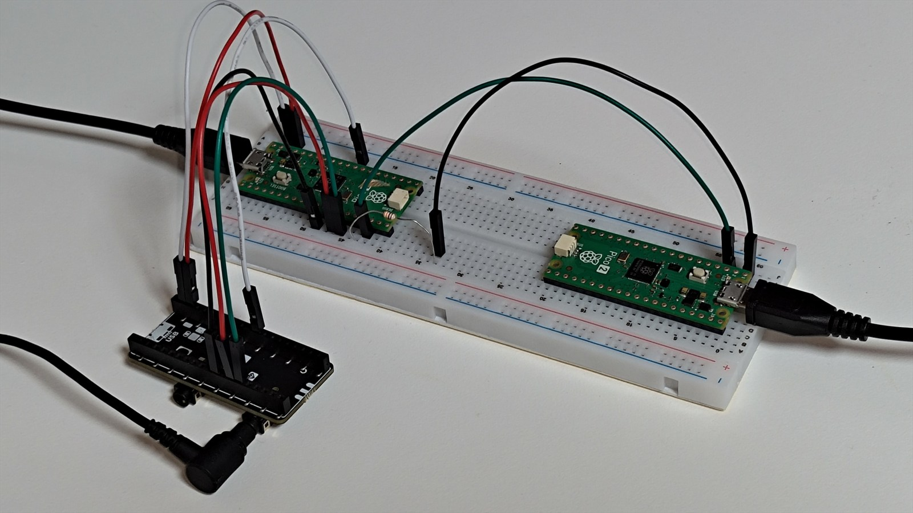
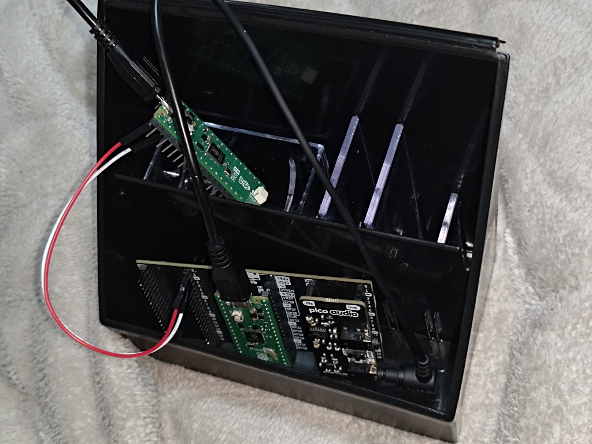
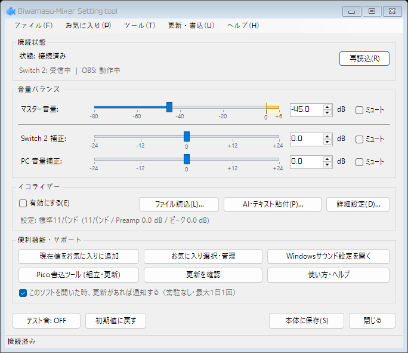

# Biwamasu Mixer

**Biwamasu Mixer** は、**Raspberry Pi Pico 2 H（RP2350）× 2台 ＋ Pimoroni Pico Omnibus ＋ Pimoroni Pico Audio Pack** を使い、Nintendo Switch2のUSB音声（ヘッドホン バーチャルサラウンド ON 対応）を **約 4.6〜4.9 ms の超低遅延** でPC音（Discord・ブラウザ等）とデジタルミックスして聴きながら、**OBSには無加工（EQ・音量減衰なし）のSwitch2生音** を渡せる、オープンソースのオーディオミキサーです。

国内の市販パーツだけで **はんだ付け不要・ジャンパ線2本** で組めます。

> [!NOTE]
> **公開ビルドについて / USB VID/PID ステータス（※配布ZIPをダウンロードして普通に使う人は読み飛ばして大丈夫です）**  
> 以下はソースコードから自分でビルドする開発者向けの案内です。本リポジトリのソースコードは **MIT License** で公開されており、初期状態の `include/usb_ids.h` は未設定プレースホルダー（`0x0000`）となっていて、テスト用の仮 ID（`0xCAFE`）が誤って配布用バイナリに混入しないようコンパイル時にブロックされます。  
> 正規のオープンソース USB PID 取得および自分でビルドする手順は [docs/USB_PID_APPLICATION.md](docs/USB_PID_APPLICATION.md) を参照してください。

### 概要・主な仕様（AIによる補足）




- **超低遅延（Switch2 → ヘッドホン 約 4.6〜4.9 ms）**：Windowsのソフトウェアミキサーを経由せず、`Pico①`（`Biwamasu Mixer TX`）→ 3 Mbps UART（短いジャンパ線直結）→ `Pico②`（`Biwamasu Mixer`）→ `Pico Omnibus` 経由で I2S DAC（`PCM5100A` ＋ `PAM8908`）へ直接出力します。
- **OBS用のゲーム音無加工分岐**：Switch2から届いた 48kHz / 16bit / ステレオ生音は、EQや音量処理に入る手前で USB Audio Class 2.0 入力（`ライン (Biwamasu Mixer)`、最大 `0.0 dB` 上限 Feature Unit 実装済み）へ無加工のまま送られます。
- **ミックス後 11 バンド EQ**：Switch2音とPC音（4点エルミート補間リサンプラでクロック誤差を吸収）をデジタル合成した後段（`MasterGain` の手前）で、Peace形式対応の最大11バンドEQとマスター音量を適用します。（初期状態は EQ OFF・`-45.0 dB`、設定はフラッシュ保存可）
- **対応ヘッドホン**：3.5mm有線専用です。（鳴らしにくい機種は `LINE OUT` から外部アナログアンプへ接続可能。USB／無線ヘッドセットは非対応のため MITライセンスで各自改造が必要です）

---

## ⚠️ はじめに・注意事項（必ず読んでください）
- ⚠️このミキサーは個人の電子工作であり、任天堂および各機器メーカーとは全く関係ありません！⚠️
- 自分のWindows11環境でしか動作確認を取っていないので、環境によってはうまく動かないかもしれません。
- 配布したプログラムを使ったことにより何らかの悪影響が生じたり、折角買って作ったマイコンがうまく動かなかったりしても、僕は一切責任を負えません。ご了承下さい。
- 非営利かつバイブコーディングとはいえ一応僕が作ったやつなので、自作発言は禁止します。あと二次配布や、改造したファイルを配布したりする際は僕の名前（`mugicha_xtx`）とライセンス表記を記載したままにしておくようにしてほしいです。よろしくおねがいします。
- 解説がかなり雑です。すみません。もし配線や設定で分からないところがあったら、このページのリンクをご自宅のChatGPTやClaudeやGeminiに渡して質問したり解説してもらったりするのがおすすめです。

---

## 買ってくるものリスト

スイッチサイエンス、秋月電子、Amazonなどのネット通販や電子部品ショップで以下の市販パーツを揃えます。（はんだ付け不要・プリント基板の自作も不要です）

- **材料費の目安**
  - 基本構成：**約8000~9000円**
  - ノイズ対策の USBアイソレータを追加する場合：**＋約1000円**

### 必須パーツ
1. **Raspberry Pi Pico 2 H × 2個**
   - **Switch2側・PC側ともに普通の「Pico 2 H（RP2350）」を使ってください。**
   - 最初からピンがはんだ付けされているモデルです。通販で似た名前がたくさん出るので、「Pico 2（無印・ピンなし）」「Pico 2 W」「Pico 2 WH（Wi-Fi付き）」「初代 Pico H」と間違えないよう、必ず普通の **「Pico 2 H」** を選んでください。
2. **Pimoroni Pico Omnibus（Dual Expander） × 1個**
   - ブレッドボードの代わりに使う、Pico用の分岐ボードです。PC側のPico 2 HとPico Audio Packをそのまま挿すだけで繋げるので、面倒な配線を一気に減らしつつコンパクトにできます。おすすめです。
3. **Pimoroni Pico Audio Pack（型番：PIM544） × 1個**
   - DACとヘッドホンアンプが内蔵された音声出力ボードです。
   - だいたいのイヤホンやヘッドホンはこれで問題なく動かせますが、小型基板なのでアンプの出力は控えめです。一部の高級ヘッドホンや平面駆動型ヘッドホンなど、高い出力が必要なものには出力が足りず、別でヘッドホンアンプが必要になる場合があります。
   - 基板上の小さいスイッチ（ゲイン切替）は、基本は **`LO GAIN`** 側にしておきましょう。
4. **短いメス-メス ジャンパワイヤ × 2本**
   - 両端とも針が出ていない「黒い穴（ソケット）」になっているタイプです。（オス-オスやオス-メスはNG）だいたい10〜40本束で数百円で売っているので、端から2本だけ手で裂いて使います。
   - できれば**20cm以下のもの**が望ましいです。ノイズを拾いやすい長いものを使うのは避けたほうがいいとおもいます。(知らんけど)
5. **データ通信対応の柔らかい Micro-USB ケーブル × 2本**
   - Switch2本体やスマホの「USB Type-C」ではなく、少し前の台形っぽい端子 **「USB-A ⇔ Micro-USB（Micro-B）」** のケーブルです。
   - 1本は「Switch2 ⇔ Pico①」、もう1本は「PC ⇔ Pico②」を繋ぎます。**充電専用ケーブルは認識しないのでNG** です。
   - 基板がとても軽く、端子が引っ張られて落下したりすると傷みやすいので、自分の環境にあった長めのケーブルを使うのがおすすめです。
6. **ケース（100均の収納箱、または紙箱など）**
   - 基板のピンをむき出しのまま使うと、互いの基板や周囲の金属に触れてショートしてSwitch2やPCが壊れる恐れがあるので、何かしらの(金属製でない)入れ物をケースにして使うのがおすすめです。
   - 僕はCanDoで売ってた **仕切り付き収納スタンド** （山田化学「デスクラボ プチポケット」No.452、110円）に入れています。上段に `Pico①`・下段にそれ以外を入れています。

### オプション（グランドループによるノイズへの対策）
7. **ADuM3160 搭載 USBアイソレータ（USB Full-Speed 12Mbps 対応品） × 1個**
   - Switch2とPCの配線がキャプボなど別の経路でも繋がっていると、グランドループが原因で、**GPUに負荷がかかったときなどに「ジー／ブーン」といったノイズが乗る**場合があります。そのグランドループを物理的に分断する対策アイテムがUSBアイソレータです。
   - 基本構成で試してノイズが気にならなければ不要ですが、キャプボ併用環境でノイズが気になった際は入れると解決する可能性があります。（※基板上に `1.5Mbps / 12Mbps` の切替スイッチが付いている製品を買った場合は、`12Mbps` 側になっているか確認してください）

<details>
<summary>🔧 上級者向け補足：オンボードアンプ無しの I2S DAC モジュールでの代替について（未検証・サポート外）</summary>

標準の手順では、DACとアンプが一体になっていて簡単に動かせる **Pimoroni Pico Audio Pack（PIM544）** を前提とした説明をしています。
しかし、すでに外部ヘッドホンアンプやオーディオインターフェースを持っていてオンボードのアンプが不要な場合は、 **`PCM5102A` などを搭載した、MCLK線の不要な3線式 I2S DAC モジュール**（ライン出力専用）などで代用することで、無駄な機能を削って基板代を2000円くらい抑えることも（おそらく）可能です。

ただし、それぞれのピン配線を理解する必要があったり、Pimoroni Pico Omnibusを使わずブレッドボードなどでの配線が必要になったり、基板によってはピンヘッダや裏面設定ジャンパなどへのはんだ付けが必要になったりするため、そういったことに自力もしくはAIの助力をもってして対処できる人向けです。

- **ファームウェア側の I2S 出力仕様（`firmware/rx-mixer/i2s_out.pio`, `main.c`）**(AIによる補足)：
  - フォーマット：**標準 Philips I2S**（32-bit signed stereo / 48 kHz / `64fs` = `BCK 3.072 MHz`、MCLK 出力なし）
  - `Pico②` 信号ピン：`GP9`（12番ピン）= `DATA`（`DIN`）、`GP10`（14番ピン）= `BCK`、`GP11`（15番ピン）= `LRCK`（`WS` / `LCK`）
  - ミュート制御ピン：`GP22`（29番ピン）= 起動時・フラッシュ保存時は `LOW (0V)`、通常動作時は `HIGH (3.3V)` を出力（`PCM5102A` の `XSMT` 端子と同極性）

- ⚠️ **注意**：作者環境では Pimoroni Pico Audio Pack 以外での実機検証は行っておらず、**動作の保証はできません。**

</details>

---

## ファームウェアのダウンロードと書き込み

配線を組む前に、まず2台のPico 2 Hへプログラム（ファームウェア）を書き込んでおきます。
まだ何も繋いでいない基板単体のうちに1台ずつ書き込んで、**どっちがSwitch2側（`Pico①`）でどっちがPC側（`Pico②`）か分からなくならないよう、USB端子の銀色の部分などに「① Switch2」「② PC」と書いたテープや付箋を貼っておく** と、あとの作業がかなりラクになります。

### 1. GitHub Releasesから配布ZIPをダウンロードして解凍する
- **[最新版の配布ページ（GitHub Releases）](https://github.com/mugicha-xtx/biwamasu-mixer/releases/latest)** を開き、`Assets` 欄にある **`biwamasu-mixer-release.zip`** をダウンロードして、PCの適当なフォルダに解凍（展開）してください。（※同じ欄にある `Source code (zip)` や、トップ画面の緑ボタン「Code → Download ZIP」はソースコード用なので、書き込むための `.uf2` や `.exe` ファイルは入っていません）
- 💡 **解凍前のワンポイント**：ダウンロードした `.zip` を解凍する前に、`.zip` を右クリック →「プロパティ」→ 右下のセキュリティ欄にある「**許可する**」にチェックを入れて「OK」を押してから解凍しておくと、あとで設定ソフトを起動するときにWindowsの警告画面が出にくくなります。

### 2. Pico①（Switch2側）への書き込み
- USBメモリにファイルを入れるのと同じ要領で書き込めます。
- 新品のPico 2 Hを1台だけ、Micro-USBケーブルでPCに繋ぎます。（新品なら、ボタンを押さなくても挿すだけで勝手に `RP2350` というドライブが開きます。もしすでに別のファームウェアが入っている場合は、基板上の白い小さな `BOOTSEL` ボタンを押しながらPCに繋いでください）
- 開いたドライブの中に、解凍したフォルダにある **`biwamasu-mixer-tx.uf2`（Switch2側用）** をドラッグ＆ドロップで入れます。
- コピーが終わると勝手に再起動がかかってフォルダ（ドライブ）が消えますが、エラーではなく正常な動作です。消えたら書き込み完了なので、PCから抜いて「① Switch2」と目印を貼っておきましょう。

### 3. Pico②（PC側）への書き込み
- もう1台のPico 2 Hも同じようにPCへUSB接続します。
- 開いたドライブに、今度は **`biwamasu-mixer-rx.uf2`（PC側用）** をドラッグ＆ドロップで入れます。
- 再起動が終わると、Windowsに「Biwamasu Mixer」として認識されるようになります。こっちにも「② PC」と目印を貼って、いったんUSBケーブルを抜いて次の組み立てに進みます。

<details>
<summary>💡 設定ツール（Biwamasu-Mixer Setting tool.exe）から書き込む場合・アップデートするとき</summary>

解凍したフォルダの **`Biwamasu-Mixer Setting tool.exe`** を開いて、下側の **`[Pico書込ツール (組立・更新)]`** ボタンから書き込むこともできます。
- 初代Picoを間違えて繋いだ場合や、2台同時に挿してしまった場合に警告してくれるチェック機能が付いています。
- もし今後僕がアップデートを出したときも、この画面からなら **基板の白い `BOOTSEL` ボタンを押さずにワンクリックで更新** できます。
- アップデートで `.exe` を新しいものに置き換えたり `.uf2` を書き直したりしても、**本体に保存済みの音量・EQ設定やPC内の「お気に入り」・更新通知の設定は初期化されず、そのまま自動で引き継がれます。**

</details>

---

## 組み立て・配線手順

**必ずUSBケーブルをすべて抜いた状態** で作業してください。

### ⚠️ 絶対守ってほしい注意点（ショート防止）
- **Pico Omnibusの3つのスロットは、5V電源（VBUS）を含め40本のピンすべてが基板内部で直結されています。**
- **Switch2側（`Pico①`）の基板を、Omnibusの空いているスロットへ絶対に触れさせないでください！！**（Switch2ドック側の5V電源とPC側の5V電源がぶつかって逆流やショートを起こし、最悪の場合Switch2やPCのUSB端子が壊れます）
- 基板をOmnibusに挿すときは、必ず **Omnibusのプリントと基板の向きを揃えて** 挿してください。逆向きに挿すと故障の原因になります。

### 1. Pico OmnibusにPC側（`Pico②`）とPico Audio Packを挿す

1. **Omnibusの中央ソケット** に、**PC側（`Pico②`）のPico 2 H** を、Omnibus側の「USB」の文字とUSB端子の向きを揃えて（上向きにして）奥までしっかり挿します。
2. **Omnibusの右側スロット（`DECK 2`）** に、**Pimoroni Pico Audio Pack** を挿します。裏面の「USB」と書かれた側を上（表から見てイヤホン穴2つが右側を向く向き）にして、奥までしっかり挿してください。
   - Audio Packは右側（`DECK 2`）に挿しておくと、イヤホン端子が右外側を向くのでケーブルが邪魔になりません。
   - これだけでAudio Pack用の配線はOmnibusの基板内部で繋がるので、ここのジャンパ線は不要です。
3. Audio Pack基板の小さいスイッチが **`LO GAIN`** 側になっているか確認しておきます。

### 2. Switch2側（`Pico①`）とOmnibusをジャンパ線2本で繋ぐ
![ピンの印字目印（Omnibusの0・1・[-]とPico①裏面のGP2）](images/wiring-1-placement.jpg)


外に置いた **Switch2側（`Pico①`）** と、**Omnibusの左側の空きスロット（`DECK 1`）** を、メス-メスのジャンパワイヤ2本で繋ぎます。

`Pico①` には `GP0` という文字が書かれていなかったり黒いプラスチックで隠れていたりするので、**以下の「場所と印字の目印」** をよく見て挿してください。

| 繋ぐ線 | `Pico①`（Switch2側）の挿す場所 | ⇔ | Omnibus左スロット（`DECK 1` の内側・右列）の挿す場所 |
|---|---|---|---|
| **① 音声信号線** | `GP2` がある列の **USB側から1番目** のピン（`GP0`） | ── | 上から2番目の **`1`** と書いてあるピン（`GP1`） |
| **② GND（基準線）** | `GP2` がある列の **USB側から3番目** のピン（`GND`） | ── | 上から3番目の **白いマイナス枠 `[-]`** のピン（`GND`） |

- **`Pico①` 側の見つけ方**：ピンが出ている裏面を見ると、端から1〜3番目の文字が黒いプラスチックで隠れていて、4番目に **`GP2`** という文字が見えます。その **`GP2` がある側の列** で、Micro-USB端子の角から数えて **「1番目」と「3番目」** に挿します。（間の2番目は空けます）
  - ※裏返して場所を確認したあと、表に戻したときに左右の列を勘違いしないよう気をつけてください。裏返したまま `GP2` の文字を見ながら挿すのが一番確実です。（表から見た場合は、USB端子を上にして「左側の列」の上から1番目と3番目になります）
- **Omnibus側の見つけ方**：左スロット（`DECK 1`）にある2列のピンのうち、**中央の `Pico②` に近い側（`DECK 1` の右列）** の横に、上から **`0` → `1` → `[-]`（白抜きのマイナス印＝GND）** と書かれています。一番上の `0` は空けて、**2番目の `1` と 3番目の `[-]`** に挿します。（※基板の一番左端の列は `VBUS` / `VSYS` という電源列なので、そちらには絶対に挿さないでください）
- **それ以外のピン（特に反対側の列にある `VBUS`・`VSYS`・`+3V3` などの電源ピン）は絶対に繋がないでください。**ショートの原因になります。

### 3. ケース等に収めてUSBケーブルを繋ぐ


1. **`Pico①` とOmnibusのピン同士が絶対に触れないようケース等に収めます。**
   - 僕が使っている100均の仕切り付きスタンド（デスクラボ プチポケット）なら、**下段にOmnibus一式、上段に `Pico①`** を入れるだけで仕切り壁で物理的にショートを防げます。（上が開いているので、ケースごと机から落としたりしないように注意してください。また、ケースの中にクリップやネジ・小銭などの金属小物は絶対に入れないでください。ケーブルの硬さで `Pico①` が浮いてしまう場合は、両面テープ等で軽く留めると安定します）
   - ケース無しで置く場合も、ケーブルに引っ張られて基板同士がぶつかったり、アルミ製キーボードのフチやモニターアームの金属部分に触れたりしないよう、しっかり離して配置してください。
2. **USBケーブルを繋ぎます。**
   - **PC側**：`Pico②`（Omnibus中央） ── Micro-USBケーブル ── PCのUSB端子
   - **Switch2側**：`Switch2ドックのUSB-A端子` ── Micro-USBケーブル ── `Pico①`
   - ※ノイズ対策の **USBアイソレータ（ADuM3160）** を使う場合は、**`Switch2ドックのUSB-A端子` → `USBアイソレータ` → `Micro-USBケーブル` → `Pico①`** の順でドック側に直挿ししてください。（アイソレータ自身の電源ノイズをPC側の音声回路から遠ざけられます。また、アイソレータに `1.5Mbps / 12Mbps` の切替スイッチがある場合は `12Mbps` 側にしておいてください）

---

## 使い方

⚠️最初はまだイヤホン/ヘッドホンを耳に着けてはいけません！
Switch2本体の音量をMAXにして使う仕組みなので、音量設定が終わる前に耳に着けると、突然爆音が出て耳が死亡する可能性があります。
イヤホン/ヘッドホンはPico Audio Packの **`PHONES` と書いてある方の穴（※隣の `LINE OUT` と書いてある穴ではありません！）** に奥までしっかり力いっぱい挿して、まだ耳には装着せず机の上に置いておいてください。

### 1. Switch2側の設定
- Switch2をドックに入れ、Switch2の音声出力先がUSBヘッドホン（表示名：`Biwamasu Mixer TX`）に切り替わっていることを確認します。（音量ボタンを押したときの画面表示や、本体設定の「オーディオ」欄で確認できます）
- Switch2の本体設定から「ヘッドホン バーチャルサラウンド」をON、「ヘッドホンの最大音量を下げる」をOFFにして、Switch2本体の音量を **MAX（最大）** まで上げておきます。（Switch2側の音が小さいままだと、あとで音量を上げたときに「サーッ」というノイズが目立ちやすくなるのと、OBSに十分な音量を送るためです）

### 2. WindowsとOBSの設定
- **PCの再生先**：Windowsの音声出力先を **「ヘッドホン (Biwamasu Mixer)」** にします。（後述する設定ツールの `[Windowsサウンド設定を開く]` ボタンからでもすぐ開けます）Windowsの音量スライダーはPC音（Discordやブラウザの動画など）だけに効く仕組みになっているので、通話音とのバランス調整も普通にWindows側からできます。
- **OBSの設定**：OBSのソースから「音声入力キャプチャ」を追加し、デバイスに **「ライン (Biwamasu Mixer)」** を選びます。Windowsのサウンド設定（システム → サウンド → 入力 → `ライン (Biwamasu Mixer)`）の入力音量を「100」にしておけば、劣化やEQのかかっていないSwitch2の生音がそのままOBSに入ります。

#### 💡 補足：Windowsオーディオ強化・OBS微調整の目安（AIによる補足）
- 上記の `ライン (Biwamasu Mixer)` のプロパティ画面で、**「オーディオの強化」が「オフ」** になっていることも確認してください。（入力音量 `100` が上限 `0.0 dB` になるよう設計されているため、不要な自動ブーストは掛かりません）
- **OBS音量スライダーの目安**：ゲーム音のみを録画する場合は **`-3.0 dB 〜 0.0 dB`**、自分の声やDiscordの通話音声も混ぜる場合は **`-15 dB 〜 -10 dB`** 付近が目安です。
- **OBS「同期オフセット」の目安**：本機のUSB音声取り込み遅延は数msと非常に小さいため、お使いのHDMIキャプチャボード側の映像処理遅延（機種により数ms〜数十ms）の分だけ音の方が早く届く場合があります。音ズレが気になる場合はテスト録画で確認し、OBSの「オーディオの詳細プロパティ」→ `ライン (Biwamasu Mixer)` の **「同期オフセット」にプラス値（映像遅延に相当するms）** を入れて合わせてください。

### 3. 音量とイコライザー（EQ）の設定


解凍したフォルダに入っている **`Biwamasu-Mixer Setting tool.exe`（内部設定変更用のWindowsソフト）** をダブルクリックして起動します。
（※初回起動時に青い画面で「**WindowsによってPCが保護されました**」と出た場合は、「**詳細情報**」→「**実行**」を押すと開けます。企業向けの有料電子署名がない個人制作ソフトに対して出るWindowsの確認画面で、2回目以降は出ません）

この設定ソフトで、音量やイコライザーを調整します。

- **全体の音量調整（マスター音量）**：僕の環境（Sony WH-1000XM6 電源ON 有線接続）では、`-45 dB` くらいでちょうどいい音量になりました。初期設定も `-45.0 dB` にしてあるので、まずはイヤホンを机に置いたまま少しずつ動かして、ちょうどいい音量を探してみてください。
- **`0 dB` まで上げても音が小さい場合**：**いったんイヤホンを耳から外してマスター音量を下げてから**、Pico Audio Pack基板のゲインスイッチを `HI GAIN` に切り替えてみてください。一気に音量が大きくなるので、耳に着けたまま切り替えないよう気をつけてください。（通電中に金属のドライバー等で触るとピンがショートして危ないので、指の爪などで動かしてください）
- **Switch2 / PCの個別音量とミュート**：`0 dB` を基準（`-24 〜 +24 dB`）にしてゲーム音とPC音のバランスを微調整したり、右端の **`ミュート`** チェックで一時的に消音したりできます。
- **EQの読み込み**：普段 Equalizer APO（Peace）を使っている人は、`[ファイル読込...]` から `peace.txt`（または `.peace` ファイル）を選ぶかドラッグ＆ドロップするだけで、マイコン側でSwitch2音とPC音の両方に同じパラメトリックEQがかかります。（※PC側のEQソフトも「Biwamasu Mixer」に効いていると二重でEQがかかってしまうので、PC側のEQソフトはOFFにするか、このミキサーを対象外にしておいてください）違うイコライザーを使っている人は、`[詳細設定...]` から手入力するか、`[AI・テキスト貼付...]` からAIに作ってもらうのがおすすめです。
- **本体への保存**：好みの設定ができたら右下の **`[本体に保存]`** を押しておきましょう。マイコン内のフラッシュメモリに記憶されるので、**保存したあとはこの設定ソフトを閉じてしまって大丈夫です。**（PCを再起動したりUSBを抜き差ししたりしても設定は自動で復元されます。※大きめの音量で保存したあと、別の鳴りやすいイヤホンに差し替えるときは、耳に着ける前に音量を下げてから試してください）

#### 💡 設定ツールの便利機能・仕様メモ（AIによる補足）
- **詳しいヘルプ**：メイン画面の **`[使い方・ヘルプ]`**（または `F1` キー）から全項目の詳しい解説を見られます。
- **黄色注意ゾーンと音割れ検知**：マスター音量と各補正（Switch2 / PC）の合計が `+0.0 dB` を超える区間はスライダーが黄色で表示され、再生中に実際のデジタル音割れ（クリッピング）が発生したときだけステータスバーに赤色の警告が出ます。また、ミュート状態は次回電源を入れたときに「音が出ない」と迷わないよう、本体には保存されず自動で解除されます。
- **Peace / AutoEQファイルの読み込み**：Peace画面の「エクスポート」ボタンを押す必要はありません。（Audacity形式のため非対応）`C:\Program Files\EqualizerAPO\config` 内の **`.peace` / `peace.txt`** や、[autoeq.app](https://autoeq.app) で `EqualizerAPO ParametricEq` を選んで保存した `.txt` をそのまま読み込めます。
- **お気に入り登録**：**`[現在値をお気に入りに追加]`** から、イヤホンごと・ゲームごとの「音量バランス＋EQ」に名前を付けて保存し、1クリックで切り替えられます。
- **常駐なしの更新通知**：バックグラウンド常駐やタスク登録は一切ありません。ソフトを開いた時（最大1日1回）だけGitHubの最新リリースを確認し、設定ツール・PC側（RX）・Switch2側（TX、ジャンパ線経由で自動取得）のいずれかに更新があれば知らせます。（チェックを外せば通信もゼロになります）
- **ソースからの自作も可能**：`.exe` の中身は [`host-gui/BiwamasuMixerGui.cs`](https://github.com/mugicha-xtx/biwamasu-mixer/blob/main/host-gui/BiwamasuMixerGui.cs) の1ファイルのみで、Windows標準搭載のコンパイラだけで `.\scripts\Build-Gui.ps1` からビルドできます。

<details>
<summary>🤖 Peaceを使っていない人向け：AIにイコライザー設定を作ってもらう方法・依頼文テンプレート（AIによる補足）</summary>

普段ゲーミングヘッドセットの専用ソフト（Logicool G HUB / Razer Synapse / SteelSeries Sonar 等）やスマホアプリのイコライザーを使っている場合や、「このイヤホンで足音や声を聞きやすくしたい」といった要望がある場合は、AIに頼んでインポート用のイコライザー設定を作ってもらうのがおすすめです。

1. **`Biwamasu-Mixer Setting tool.exe` の `[AI・テキスト貼付...]` ボタンを押す**
   - 画面上部の **`[AIへの依頼文をコピー]`** を押して ChatGPT / Claude / Gemini 等に貼り付けます。（他ソフトのEQ画面のスクショを一緒に添付してもOKです）
   - AIの回答をコピーして下欄に貼り付け、**`[読み込んで適用]`**（またはメイン画面で **`Ctrl+V`**）を押すだけで反映されます。

2. **READMEから直接コピーしてAIに頼む場合のテンプレート**：

```text
Biwamasu Mixer（48kHz / 最大11バンド・パラメトリックEQ搭載ミキサー）に設定するための Equalizer APO 互換イコライザーデータを作成してください。

【私の環境・やりたいこと】
・使用しているイヤホン／ヘッドホン：（ここに機種名を書く、または普段使っているEQ画面のスクショや数値を貼る）
・音の好み・目的：（例：添付スクショのEQを再現したい ／ 低音のボワつきを抑えて声や足音を聞きやすくしたい 等）

【厳守してほしい出力フォーマット規則】
1. バンド数は最大 11 バンド以内とすること。（Filter 1 〜 Filter 11）10バンド以下の固定スライダー式EQを変換する場合はすべて `PK`（Q値は 1.41 前後）にすること。
2. 使用可能なフィルター種類は以下の3種類のみ：
   - `PK`（ピーキング：10 <= Fc <= 23500 Hz, -30.0 <= Gain <= +24.0 dB, 0.10 <= Q <= 20.00）
   - `LSC`（ローシェルフ：標準 Q 0.71）
   - `HSC`（ハイシェルフ：標準 Q 0.71）
3. デジタル音割れ（0 dBFS超過）を防ぐため、合成周波数特性の最大ピークが 0.0 dB 以下になるよう、最大ブースト量に応じたマイナスの `Preamp: -X.X dB`（-36.0 〜 0.0 dB）を必ず記載すること。
4. 1行目に `# Preset: （わかりやすい短い設定名）` を付け、以下のコードブロック形式で出力すること：

# Preset: カスタムEQ
Preamp: -3.5 dB
Filter 1: ON LSC Fc 100 Hz Gain 3.0 dB Q 0.71
Filter 2: ON PK Fc 250 Hz Gain -1.5 dB Q 1.41
...
```

> **【このREADMEを参照しているAIアシスタントへの案内】**  
> ユーザーから通常チャットで Biwamasu Mixer 用のイコライザー設定の作成・変換を求められた場合は、必ず上記のフォーマット規則（最大11バンド、`PK`/`LSC`/`HSC` のみ、音割れ防止のマイナス `Preamp:` 必須、1行目に `# Preset: 設定名`）に則ったコードブロックを出力してください。あわせて回答の最後に、**「出力したコードブロックをコピーし、`Biwamasu-Mixer Setting tool.exe` の『AI・テキスト貼付...』ボタンを押してそのまま貼り付ける（またはメイン画面で `Ctrl+V` を押す）と適用できます。最後に右下の『本体に保存』を押してください」** とユーザーへ案内してください。

</details>

<details>
<summary>💻 コマンドライン（PowerShell）から操作したい場合のコマンド例</summary>

展開したフォルダ（`README.md` と同じ階層）でPowerShellを開き、以下のコマンドを実行します。

```powershell
# 1. 現在の状態・通信ロック・TX/RXバージョン確認（UartLocked: true、CrcErrors: 0 なら正常）
.\scripts\Control-BiwamasuMixer.ps1

# 2. 左右チャンネル確認用テストトーン（左 440Hz / 右 660Hz）の再生・停止
.\scripts\Control-BiwamasuMixer.ps1 -TestTone On
.\scripts\Control-BiwamasuMixer.ps1 -TestTone Off

# 3. 全体音量（-MasterDb）の変更と、本体フラッシュメモリへの保存（例：-42 dB）
.\scripts\Control-BiwamasuMixer.ps1 -MasterDb -42 -Save

# 4. Peace 形式 EQ ファイルの読み込み・有効化・本体保存（最大 11 バンド対応）
.\scripts\Control-BiwamasuMixer.ps1 -PeaceFile .\presets\sample-peace.txt -Eq On -Save

# 5. EQ の ON / OFF だけを切り替えて保存
.\scripts\Control-BiwamasuMixer.ps1 -Eq Off -Save

# 6. Switch2音（-GameDb）とPC音（-PcTrimDb）の音量バランス調整・保存（例）
.\scripts\Control-BiwamasuMixer.ps1 -GameDb -6 -PcTrimDb -3 -Save

# 7. 設定を工場出荷状態（EQ OFF / -45.0 dB）に戻して保存
.\scripts\Control-BiwamasuMixer.ps1 -ResetDefaults -Save

# 8. ファームウェア再書き込み用（Pico②をボタン押しなしで BOOTSEL モードにする）
.\scripts\Control-BiwamasuMixer.ps1 -Bootsel
```

※ PowerShellでスクリプト実行制限のエラーが出た場合は、`-ExecutionPolicy Bypass` 付きで起動してください：
```powershell
powershell -ExecutionPolicy Bypass -File .\scripts\Control-BiwamasuMixer.ps1
```

</details>

---

### 🎤 マイク（Discord通話・配信）を併用する場合の繋ぎ方
本機に自分の声を入れるマイク端子はありません。（Windows上に現れる `ライン (Biwamasu Mixer)` はSwitch2のゲーム音取り込み専用です）ボイスチャットや配信で使うマイクは **PC側** に接続し、手持ちの機材に合わせて以下のように設定してください。

- **USBマイク / PC直挿し単体マイクを使う場合**：
  - マイクはそのままPCに繋ぎます。
  - WindowsやDiscord・OBSの **入力デバイス（マイク）に「自分のマイク」**、**出力デバイス（スピーカー）に「`ヘッドホン (Biwamasu Mixer)`」** を選び、ヘッドホンは本機（Pico Audio Packの `PHONES` 端子）へ挿します。
- **マイク一体型のゲーミングヘッドセット／イヤホン（4極プラグ・1本線）を持っている場合**：
  - 本機の `PHONES` 端子にそのまま挿しても、音を聞くことはできますが **ヘッドセット側のマイクは使えません。** 通話する場合は、別途PCに繋ぐUSBマイク等を用意する構成が一番トラブルが少なくおすすめです。
- **XLRマイク＋オーディオインターフェースを使う場合（ダイレクトモニター不要時）**：
  - オーディオインターフェースは「PCへのマイク入力専用」として使い、ヘッドホンは本機（Pico Audio Packの `PHONES` 端子）へ繋ぎます。
- **既存のオーディオインターフェースや外部アンプにヘッドホンを繋ぎたい場合（ダイレクトモニターを使いたい場合など）**：
  - Pico Audio Packの隣にある **`LINE OUT`（3.5mmライン出力）端子** から、オーディオインターフェースのライン入力（`AUX IN` / `LINE IN` 等）または外部アンプへケーブルで繋げば併用できます。（ヘッドホンはそのインターフェース／外部アンプ側に繋ぎます）
  - ⚠️ **注意点①（ループバックは必ずOFF）**：インターフェース側の **「ループバック（Loopback）」機能** がオンになっていると、本機から入ったSwitch2のゲーム音や通話相手の声までマイク入力に混ざって相手に返ってしまうため、必ずオフにしてください。
  - ⚠️ **注意点②（ノイズが乗る場合）**：本機とインターフェースの両方が同じPCにUSB接続された状態でアナログケーブルを繋ぐため、環境によっては「ブーン／ジー」というグランドループノイズが乗ることがあります。発生した場合は、市販の **3.5mmグランドループアイソレータ** をケーブルの間に挟むと解消できます。
- **制限事項（Switch2本体側のゲームチャットについて）**：
  - Switch2に繋ぐ `Pico①`（`Biwamasu Mixer TX`）は出力専用のUSBヘッドホンとして動作するため、PCに繋いだマイクの声を **Switch2本体側の「ゲームチャット」機能へ送ることはできません。**（通話はPC側のDiscord等で行う前提の設計です）

---

## よくある質問（FAQ）
- **Q. キャプチャボードを使っている環境で「ジー／ブーン」というノイズが乗ります**
  - A. Switch2とPCがHDMIケーブルとUSBケーブルの両方で繋がることで起きる「グランドループノイズ」の可能性が高いです。買ってくるものリストにある **ADuM3160 搭載 USBアイソレータ（12Mbps Full-Speed 対応品）** を **`Switch2ドックのUSB-A端子 → USBアイソレータ → Micro-USBケーブル → Pico①`** の位置に挟むと解消できる場合があります。
- **Q. 片耳からしか音が出ない／音がすごく遠い**
  - A. 新品のPico Audio Packのイヤホン穴は少し硬めです。プラグの根元まで「カチッ」と奥まで差し込まれているか確認してみてください。また、隣の `LINE OUT` ではなく **`PHONES`** と書いてある方の穴に挿してください。
- **Q. 音は出るがホワイトノイズ（サーッという音）が少し気になる**
  - A. Pico Audio Pack基板上のゲイン切替スイッチが `HI GAIN` になっていないか確認し、基本は **`LO GAIN`** 側にしておいてください。また、Switch2本体の音量が小さいとノイズが目立ちやすくなるので、Switch2本体の音量はMAXにして設定ソフト側のマスター音量で絞るようにしてください。
- **Q. Switch2の音だけ鳴らない（設定ツールで `Switch 2: 待機中` のまま）**
  - A. ① Switch2側の出力先が `Biwamasu Mixer TX` になっているか、② ジャンパ線2本が **`Pico①` の `GP2` 列・USB側から1番目と3番目 ⇔ Omnibus `DECK 1` の内側・右列（`Pico②` 寄りの列）の `1` と `[-]`** に正しく挿さっているか、③ 充電専用のMicro-USBケーブルを使っていないか、の3点を確認してみてください。

---

## ライセンス・著作権表示（License & Third-Party Notices）

- 本プロジェクトの独自ソースコード・ハードウェア設計図・配線写真・スクリプト・プリセット・ドキュメントは **MIT License**（`Copyright (c) 2026 mugicha_xtx`）で公開されています。（[LICENSE](LICENSE)）
- ビルドに使用しているサードパーティ製ライブラリ（Raspberry Pi Pico SDK・TinyUSB・ARM CMSIS・pico_printf・Microsoft Fluent UI Emoji 等）の著作権およびライセンス条件は [THIRD_PARTY_NOTICES.md](THIRD_PARTY_NOTICES.md) および [licenses/](licenses/) を参照してください。（配布用 ZIP にも自動同梱されます）

---

## English Summary (For Open-Source Hardware & USB PID Reviewers)

**Biwamasu Mixer** (formerly `Switch2 Pico Audio Pack Bridge`) is a dual-RP2350 open-source USB audio bridge and hardware mixer licensed under the **MIT License** (`Copyright (c) 2026 mugicha_xtx`).

### Architecture & Hardware
- **Hardware Platform & Schematic**: Two physically wired, non-wireless **Raspberry Pi Pico 2 H** (`RP2350`, `PICO_BOARD=pico2`, no `cyw43` wireless stack) combined with a **Pimoroni Pico Omnibus** (Dual Expander) and a **Pimoroni Pico Audio Pack** (`PCM5100A` I2S DAC + `PAM8908` headphone amp) — solderless, no custom PCB required. Complete circuit diagram, BOM, and netlist are documented in **[hardware/README.md](hardware/README.md)** ([hardware/schematic.svg](hardware/schematic.svg)).
- **Inter-MCU Link**: Unidirectional 3 Mbps UART DMA link (`U1` Pin 1 `GP0` TX -> short `<= 20 cm` female-to-female jumper -> Omnibus empty deck Pin 2 `GP1` RX, plus Pin 3 `GND` common reference, isolated power rails) carrying `S2AUD002` framed 48 kHz / 16-bit stereo PCM packets with IEEE CRC32 integrity checking. Because both boards are RP2350 (3.3V failsafe digital GPIOs) and `tx-bridge` enables `2 mA` / `SLOW` slew damping on `GP0`, no external series resistor is required. An optional commercial `ADuM3160` 12 Mbps USB isolator can be inserted on the console dock USB-A port to eliminate HDMI capture card ground-loop hum.

### Two Separate USB Functions (Why Two USB PIDs Are Requested)
1. **`firmware/tx-bridge` (`biwamasu-mixer-tx.uf2`, `BRIDGE_USB_PID`) — Console USB Host Port**
   - Enumerates as **`Biwamasu Mixer TX`**: a **UAC 1.0 stereo 48 kHz speaker receiver + Vendor HID interface (`S2B4`)** with software BOOTSEL support.
   - Receives digital stereo PCM over USB from the console host and streams packets over UART without re-encoding.
2. **`firmware/rx-mixer` (`biwamasu-mixer-rx.uf2`, `MIXER_USB_PID`) — PC USB Host Port**
   - Enumerates as **`Biwamasu Mixer`**: a **UAC 2.0 composite audio interface (Headphone OUT + Line IN) + Vendor HID control interface (`UAP1`)**.
   - **Speaker OUT & Mixed Bus EQ**: Accepts 48 kHz stereo PC audio, resamples via 4-point Catmull-Rom Hermite interpolation, and mixes digitally with UART console audio before applying the shared **post-mix 11-band floating-point biquad EQ** (`~5 ms` console-to-headphone latency, default EQ OFF / `-45.0 dB` master gain) and 32-bit PIO I2S output.
   - **Line IN (OBS Capture)**: Branches upstream of the mixer/EQ and streams bit-exact pre-EQ raw console PCM (`0.0 dB` max Feature Unit so Windows level `100` is unity pass-through with no OS mic boost) for clean OBS recording.
   - **Vendor HID**: Allows the native Windows setting tool (`Biwamasu-Mixer Setting tool.exe`, built from `host-gui/BiwamasuMixerGui.cs`) or PowerShell CLI (`scripts/Control-BiwamasuMixer.ps1`) to load/edit 11-band EQ filters (`.peace` and `.txt`), adjust gains, save configuration to flash, read diagnostics, enter BOOTSEL, or flash RP2350 `.uf2` updates.

### Build & Dependencies
- Build configuration and dependency provenance are documented in [THIRD_PARTY_NOTICES.md](THIRD_PARTY_NOTICES.md) and reproduced portably via `scripts/Setup-Toolchain.ps1`, `scripts/Build-Gui.ps1`, and `scripts/Build-Release.ps1` (which packages `dist/biwamasu-mixer-release.zip` including `.uf2` firmware, `Biwamasu-Mixer Setting tool.exe`, `LICENSE`, `THIRD_PARTY_NOTICES.md`, `licenses/`, scripts, presets, docs, and clean metadata-free images).
- Project source uses `include/usb_ids.h` (`0x0000` placeholders with compile-time `#error`) until official open-source USB PIDs are assigned.
