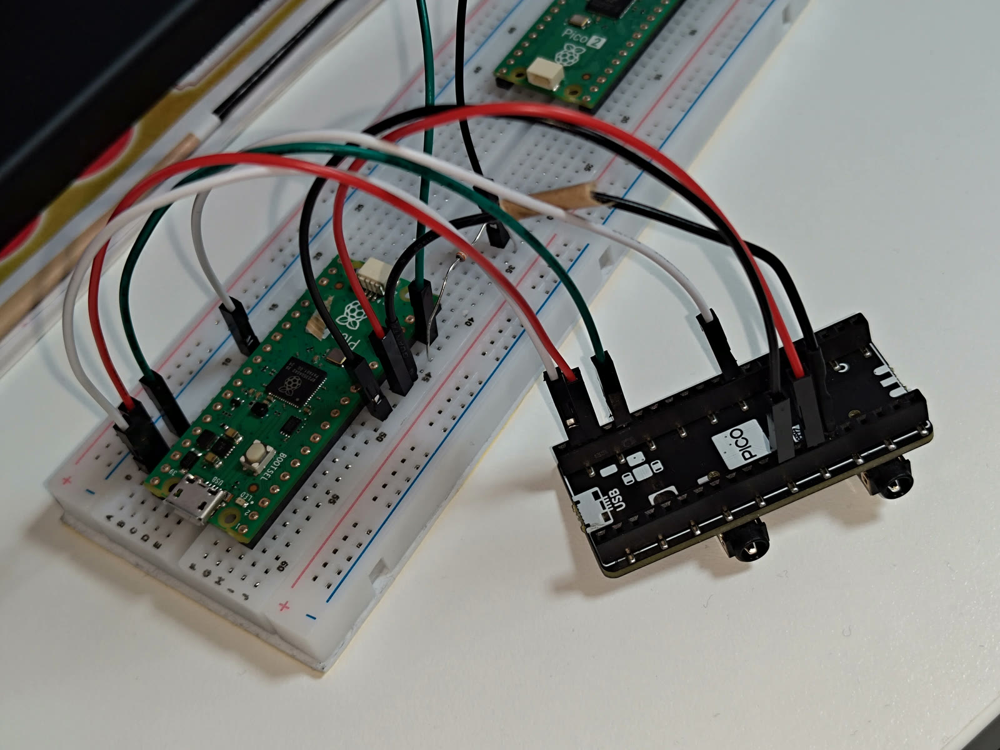

# Biwamasu Mixer

**Biwamasu Mixer** は、**Raspberry Pi Pico 2 H（RP2350）× 2台 ＋ Pimoroni Pico Audio Pack** を使い、Nintendo Switch 2 の USB 音声（ヘッドホン バーチャルサラウンド ON 対応）を **約 4.6〜4.9 ms の超低遅延** で PC 音（Discord・ブラウザ等）とデジタルミックスして聴きながら、**OBS には無加工（EQ・減衰なし）の Switch 2 生音** を渡せるオープンソースのオーディオミキサーです。

> [!NOTE]
> **公開ビルドについて / USB VID/PID ステータス**  
> 本リポジトリのソースコードは **MIT License** で公開されています。初期状態の `include/usb_ids.h` は未設定プレースホルダー（`0x0000`）となっており、テスト用の仮 ID（`0xCAFE`）が誤って配布用バイナリに混入しないようコンパイル時にブロックされます。  
> 正規のオープンソース USB PID 取得および自分でビルドする手順は [docs/USB_PID_APPLICATION.md](docs/USB_PID_APPLICATION.md) を参照してください。

### 概要・主な仕様（AIによる補足）




- **超低遅延（Switch 2 → ヘッドホン 約 4.6〜4.9 ms）**：Windows のソフトウェアミキサーを経由せず、`Pico①`（`Biwamasu Mixer TX`）→ 3 Mbps UART（`33Ω` 抵抗経由）→ `Pico②`（`Biwamasu Mixer`）→ I2S DAC（`PCM5100A` ＋ `PAM8908`）へ直接出力します。
- **OBS 用の生音分岐**：Switch 2 から届いた 48kHz / 16bit / ステレオ生音は、EQ や音量処理に入る手前で USB Audio Class 2.0 入力（`マイク (Biwamasu Mixer)`、最大 `0.0 dB` 上限 Feature Unit 実装済み）へ無加工のまま送られます。
- **ミックス後 11 バンド EQ**：Switch 2 音と PC 音（4点エルミート補間リサンプラでクロック誤差を吸収）をデジタル合成した後段（`MasterGain` の手前）で、Peace 形式対応の最大 11 バンド EQ とマスター音量を適用します（初期状態は EQ OFF・`-45.0 dB`、設定はフラッシュ保存可）。
- **対応ヘッドホン**：3.5mm 有線専用です（鳴らしにくい機種は `LINE OUT` から外部アナログアンプへ接続可能。USB／無線ヘッドセットは非対応のため MIT ライセンスで各自改造が必要です）。

---

## ⚠️ はじめに・注意事項（必ず読んでください）
- ⚠️このミキサーは個人の電子工作であり、任天堂および各機器メーカーとは全く関係ありません！⚠️
- 自分のWindows11環境でしか動作確認を取っていないので、環境によってはうまく動かないかもしれません。
- 配布したプログラムを使ったことにより何らかの悪影響が生じたり、折角買ったマイコンがうまく動かなかったりしても、僕は一切責任を負えません。ご了承下さい。
- 非営利かつバイブコーディングとはいえ一応僕が作ったやつなので、自作発言は禁止します。あと二次配布とかファイル改造後配布とかする際は僕の名前（`mugicha_xtx`）とライセンス表記を記載したままにしておくようにしてほしいです。よろしくおねがいします。
- 解説がかなり雑です。すみません。もし配線や設定で分からないところがあったら、リンク先のREADMEをご自宅のChatGPTやClaudeやGeminiに読ませて質問したり解説してもらったりするのがおすすめです。

---

## 買ってくるものリスト
秋葉原や日本橋などの電気街に行くか、もしくはネット通販（スイッチサイエンス、秋月電子、Amazonなど）で以下の部品を揃えましょう。

1. Raspberry Pi Pico 2 H × 2個
  - 必ず末尾に 「H」がついているもの（最初からピンがはんだ付けされているモデル）を買ってください。「H」無しを買うと地獄のはんだ付け作業が必要になります。
2. Pimoroni Pico Audio Pack（型番：PIM544） × 1個
  - DACとアンプが内蔵された音声出力ボードです。
  - 普通のイヤホンやゲーミングヘッドセットなど、鳴らしやすい機種なら問題なく動かせますが、小型基板なのでアンプの出力は控えめです。高い出力を要求する一部のヘッドホンでは、音量が足りない場合があります。
  - 基板についている小さいスイッチ（ゲイン切り替え）はまずは「Low」側にしておきましょう。
3. ブレッドボード（800穴サイズくらい） × 1枚
  - 部品を挿すだけで回路を導通させられる魔法の白い板です。
  - 800穴くらいのサイズのものを使えば2台のPicoを余裕を持って乗せられます。ぼくはMB-102を使いました。
4. 33Ω カーボン抵抗（1/4W） × 1本
  - なんかわからんけど、安全のために必要らしいです。
  - 通販で100本200円で手に入ります。
  - そんなに要らんわ舐めとんのかしばくぞという方は、秋月電子とか千石電商とかみたいな電子部品ショップの実店舗に行けば1本30円でバラ売りしてたりするのでそれで買うのがおすすめです。
5. ジャンパーワイヤー（オス-オス） × 8本（予備含め1セット）
  - ブレットボードとかに挿し込む♂配線コードです（GND接続に1本、Audio Pack接続に7本使います）。
6. データ通信対応の Micro USB ケーブル × 2本
  - 1本は「Switch2 ⇔ Pico①」、もう1本は「PC ⇔ Pico②」を繋ぐのに使います。充電専用ケーブルだと認識しないので、必ずデータ通信対応のものを用意してください。

---

## 配線手順

### 1. ブレッドボードにPico 2 Hを2個挿す


ブレッドボードの左端あたりに、「PC側のPico 2 H（Pico②）」をUSB左向きで、右端あたりに「Switch2側のPico 2 H（Pico①）」をUSB右向きでグッと奥まで挿します。
どっちがどっちかわからなくならないように、目印を付けておきましょう。
僕はPC側のPico 2 H（Pico②）にテープ片をつけて目印にしました。

まだUSBケーブルは挿さないでください。先に以下の配線を行います。

### ⚠️ 絶対守ってほしい注意点
**Pico①とPico②の「電源ピン（VBUS / VSYS / 3V3）」同士は、絶対に繋がないでください！！**
ここを繋いでしまうと、Switch 2ドックの電源とPCの電源が短絡みたいな事を起こして、最悪の場合Switch 2やPCのUSB端子が壊れるらしいです。(gemini談)
2台のPicoの間で繋ぐのは「信号線（抵抗経由）」と「GND」の2本だけです。

### 2. Pico①(Switch2側)と Pico②(PC側)を繋ぐ（2箇所）


- 信号線：Pico①の GP0（1番ピン） ── 33Ω抵抗 ── Pico②の GP13（17番ピン）
- GND線：Pico①の GND ──（ジャンパー線）── Pico②の GND

### 3. Pico②(PC側)と Pico Audio Pack を繋ぐ（7本）
Pico Audio Packを、穴が空いている方を上にしてブレッドボードの近くに置いてください。
Pico②のピンが刺さっているブレッドボードの列から、ジャンパー線（オス-オス）を7本伸ばして、Pico Audio Pack裏面の、同じ位置・同じ名前の穴に挿します。


- VSYS ⇔ Audio Packの VSYS
- GND ⇔ Audio Packの GND
- 3V3 ⇔ Audio Packの 3V3
- GP22 ⇔ Audio Packの GP22（MUTE）
- GP9 ⇔ Audio Packの GP9（DATA）
- GP10 ⇔ Audio Packの GP10（BCK）
- GP11 ⇔ Audio Packの GP11（LRCK）

全部挿せたら、「Pico①とPico②の電源ピン同士が繋がっていないか」「Pico Audio Packのゲイン切り替えスイッチが『LO GAIN』に入っているか」 だけ最後にもう一度指差し確認してください。

### 💡 補足：ブレッドボードの数え方・ピン位置対応表（AIによる補足）
`MB-102` はメーカーにより `A〜E` / `F〜J` や端の番号向きが異なるため、**「USB 端子を向けた側の端の足から何番目か」** と **「奥列（上）／手前列（下）」** で数えてください（上下端の `+` `-` 電源レーンは未使用）。

- **Step 2 注意**：`Pico①` の手前一番右端の足は **`VBUS`（5V）** なので、`GP0`（奥側の一番右端）と間違えないよう基板裏面の白印字を確認してください（`GP13` は `Pico②` の手前列・左から17番目、`GND` は `Pico①` 奥列右から3本目 ⇔ `Pico②` 手前列左から18番目）。
- **Step 3 対応表**（`Pico Audio Pack` は USB 印字を左・3.5mm ジャックを右に置き、`Pico②` 左端を 1番目とします。奥列・左端1番目の `VBUS` は未接続。英語ネットリストは [hardware/README.md](hardware/README.md)）：

| 機能 | `Pico②` の足（左端から） | `Pico Audio Pack` 側の穴 |
|---|---|---|
| **`VSYS` (5V)** | 奥列 **2番目** | 奥列 **2番目**（`VSYS`） |
| **`GND`** | 奥列 **3番目** | 奥列 **3番目**（`GND`） |
| **`3V3` (3.3V)** | 奥列 **5番目** | 奥列 **5番目**（`3V3`） |
| **`GP22` (`MUTE`)** | 奥列 **12番目** | 奥列 **12番目**（`MUTE`） |
| **`GP9` (`DATA`)** | 手前列 **12番目** | 手前列 **12番目**（`DATA`） |
| **`GP10` (`BCK`)** | 手前列 **14番目** | 手前列 **14番目**（`BCK`） |
| **`GP11` (`LRCK`)** | 手前列 **15番目** | 手前列 **15番目**（`LRCK`） |

---

## ファームウェアのダウンロードと書き込み
次はPico①とPico②の両方にファームウェアを書き込んでいきます。

1. GitHub Releasesからファイルをダウンロードする
  - このGitHubページの右側にある `Releases` 欄から最新の配布用ZIPファイル（`biwamasu-mixer-release.zip`）をダウンロードして、PCの適当なフォルダに解凍（展開）してください（※緑色の「Code → Download ZIP」はソースコード用なので `.uf2` ファイルは入っていません）。
2. Pico①（Switch2側）への書き込み
  - USBメモリにファイルを入れるのと同じ要領で書き込めます。
  - Pico①基板の上にある白い小さなボタン（BOOTSELボタン）を押しながら、PCにUSBケーブルで繋ぎます。
  - PCに新しくドライブが開くので、解凍したフォルダにある `biwamasu-mixer-tx.uf2`（Switch 2側用）をドラッグ＆ドロップで放り込みます。
  - 勝手に再起動してドライブが消えたら書き込み完了です。PCから抜いて、Switch2のドックのUSB端子に繋ぎます。
3. Pico②（PC側）への書き込み
  - 同じように、Pico②の白い BOOTSELボタン を押しながらPCにUSB接続します。
  - 開いたドライブに `biwamasu-mixer-rx.uf2`（PC側用）をドラッグ＆ドロップします。
  - 再起動が終わると、Windowsに「Biwamasu Mixer」として認識されます！

---

## 使い方

⚠️最初はまだイヤホン/ヘッドホンを耳に着けてはいけません！⚠️
Switch 2本体の音量をMAXにして使う仕組みなので、音量設定が終わる前に耳に着けると、突然爆音が出て耳が死亡する可能性があります。
イヤホン/ヘッドホンはPico Audio Packの **`PHONES`と書いてある方の穴（※隣の `LINE OUT` と書いてある穴ではありません！）** に挿しつつ、まだ耳には装着せず机とかに置いておくようにお願いします。

### Switch2側の設定
- Switch2をドックに入れ、Pico①をドックに接続し、Pico①がUSBヘッドホン（表示名：`Biwamasu Mixer TX`）として認識されていることを確認します。
- Switch2の設定から「ヘッドホン バーチャルサラウンド」をONにし、「ヘッドホンの最大音量を下げる」をOFFにし、Switch2本体の音量設定をMAX（最大） まで上げましょう。（S/N比を稼ぐのと、OBSに最大音量の音を送るため）

### 音量とイコライザー（EQ）の設定
解凍したフォルダに入っている `Control-BiwamasuMixer.ps1`（PowerShellスクリプト）を使います。
（※ネットで落としたスクリプトがWindowsにブロックされる場合は、ファイルを右クリック→「プロパティ」→右下の「許可する」にチェックを入れてOKを押してください）

このスクリプトから以下の設定ができます。
- 全体の音量調整（MasterDb）：僕の環境（Sony WH-1000XM6 電源ON 有線接続）では、-45dBくらいでちょうどいい音量になりました。
- 初期設定は-45dBにしてあるので、まずは小さめの音量から試して確認して、音量調節してください。
- 0dBまで上げても音が小さい場合は、Pico Audio PackのゲインスイッチをHI GAINに切り替えてみてください。音量が大きくなります。
- EQの読み込み：普段 Equalizer APO（Peace）を使っている人は、書き出した `peace.txt` を読み込ませるだけで、マイコン側でSwitch2音とPC音の両方に同じパラメトリックEQがそのままかかります（※PC側でもPeace等をONにしていると二重にEQがかかってしまうので、PC側のEQソフトはOFFにしてください）。違うイコライザを使ってる人は、がんばって自分で数値を入力するか、AIにイコライザの数値を教えて入力してもらってください。
- 本体への保存：設定をフラッシュメモリに保存すれば、次回からはPCやUSBを抜き差ししても設定が自動で復元されます。

#### 💡 コピペ用：`Control-BiwamasuMixer.ps1` 実行コマンド例（AIによる補足）
展開したフォルダ（`README.md` と同じ階層）で PowerShell を開き、以下のコマンドを実行します。

```powershell
# 1. 現在の状態・通信ロック確認（UartLocked: true、CrcErrors: 0 なら正常）
.\scripts\Control-BiwamasuMixer.ps1

# 2. 左右チャンネル確認用テストトーン（左 440Hz / 右 660Hz）の再生・停止
.\scripts\Control-BiwamasuMixer.ps1 -TestTone On
.\scripts\Control-BiwamasuMixer.ps1 -TestTone Off

# 3. 全体音量（-MasterDb）の変更と、本体フラッシュメモリへの保存（例：-42 dB）
.\scripts\Control-BiwamasuMixer.ps1 -MasterDb -42 -Save

# 4. Peace 形式 EQ ファイルの読み込み・有効化・本体保存（最大 11 バンド対応）
#    同梱の見本ファイル（presets\sample-peace.txt：全バンド 0 dB）を編集して使う場合：
.\scripts\Control-BiwamasuMixer.ps1 -PeaceFile .\presets\sample-peace.txt -Eq On -Save

# 5. EQ の ON / OFF だけを切り替えて保存
.\scripts\Control-BiwamasuMixer.ps1 -Eq Off -Save

# 6. Switch 2 音（-GameDb）と PC 音（-PcTrimDb）の音量バランス調整・保存（例）
.\scripts\Control-BiwamasuMixer.ps1 -GameDb -6 -PcTrimDb -3 -Save

# 7. 設定を工場出荷状態（EQ OFF / -45.0 dB）に戻して保存
.\scripts\Control-BiwamasuMixer.ps1 -ResetDefaults -Save

# 8. ファームウェア再書き込み用（Pico② をボタン押しなしで BOOTSEL モードにする）
.\scripts\Control-BiwamasuMixer.ps1 -Bootsel
```

※ PowerShell でスクリプト実行制限のエラーが出た場合は、同じフォルダで以下を1回実行するか、`-ExecutionPolicy Bypass` 付きで起動してください：
```powershell
powershell -ExecutionPolicy Bypass -File .\scripts\Control-BiwamasuMixer.ps1
```
※ プラグが根元まで完全に刺さっていないと「片耳しか鳴らない」状態になることがあります（新品の 3.5mm ジャックは硬めなので奥までしっかり押し込んでください）。

### Windows と OBS の設定
- PCの音声出力先を 「ヘッドホン (Biwamasu Mixer)」 にしましょう。Windowsの音量スライダーはPC音（Discordや動画など）だけに効くので、通話音とのバランス調整も簡単で
- す！
- OBSの設定：OBSのソースから「音声入力キャプチャ」を追加し、デバイスに 「マイク (Biwamasu Mixer)」 を選びます。Windows側のマイク入力音量を「100」にしておけば、音質劣化ゼロ・EQなしの綺麗なSwitch2の音がそのままOBSに入ります！

#### 💡 補足：Windows オーディオ強化・OBS 微調整の目安（AIによる補足）
- Windows「設定」→「システム」→「サウンド」→「入力」→ `マイク (Biwamasu Mixer)` 内の **「オーディオの強化」は「オフ」** にしてください（入力 `100` は上限 `0.0 dB` 設計のため自動ブーストは掛かりません）。
- **OBS 音量スライダー目安**：ゲーム音のみ録画は **`-3.0 dB 〜 0.0 dB`**、自分の声や Discord も混ぜる場合は **`-15 dB 〜 -10 dB`** 付近。
- **OBS「同期オフセット」目安**：無加工音声が映像より約 4〜5 ms 早く届くため **`0 ms`** でも 60fps で 0.3 コマ以内です（厳密に合わせるなら **`+5 ms` 前後**、キャプチャ映像側の遅延がある場合は実録で確認して調整してください）。

---

## ライセンス・著作権表示（License & Third-Party Notices）

- 本プロジェクトの独自ソースコード・スクリプト・プリセット・ドキュメントは **MIT License**（`Copyright (c) 2026 mugicha_xtx`）で公開されています（[LICENSE](LICENSE)）。
- ビルドに使用しているサードパーティ製ライブラリ（Raspberry Pi Pico SDK・TinyUSB・ARM CMSIS・pico_printf 等）の著作権およびライセンス条件は [THIRD_PARTY_NOTICES.md](THIRD_PARTY_NOTICES.md) および [licenses/](licenses/) を参照してください（配布用 ZIP にも自動同梱されます）。

---

## English Summary (For Open-Source Hardware & USB PID Reviewers)

**Biwamasu Mixer** (formerly `Switch2 Pico Audio Pack Bridge`) is a dual-RP2350 open-source USB audio bridge and hardware mixer licensed under the **MIT License** (`Copyright (c) 2026 mugicha_xtx`).

### Architecture & Hardware
- **Hardware Platform & Schematic**: Two physically wired, non-wireless **Raspberry Pi Pico 2 H** (`RP2350`, `PICO_BOARD=pico2`, no `cyw43` wireless stack) paired with a **Pimoroni Pico Audio Pack** (`PCM5100A` I2S DAC + `PAM8908` headphone amp). Complete circuit diagram, BOM, and netlist are documented in **[hardware/README.md](hardware/README.md)** ([hardware/schematic.svg](hardware/schematic.svg)).
- **Inter-MCU Link**: Unidirectional 3 Mbps UART DMA link (`GP0` TX -> `33Ω` series resistor -> `GP13` RX, common `GND`, isolated power rails) carrying `S2AUD002` framed 48 kHz / 16-bit stereo PCM packets with IEEE CRC32 integrity checking.

### Two Separate USB Functions (Why Two USB PIDs Are Requested)
1. **`firmware/tx-bridge` (`biwamasu-mixer-tx.uf2`, `BRIDGE_USB_PID`) — Console USB Host Port**
   - Enumerates as **`Biwamasu Mixer TX`**: a **UAC 1.0 stereo 48 kHz speaker receiver + Vendor HID interface (`S2B4`)** with software BOOTSEL support.
   - Receives digital stereo PCM over USB from the console host and streams packets over UART without re-encoding.
2. **`firmware/rx-mixer` (`biwamasu-mixer-rx.uf2`, `MIXER_USB_PID`) — PC USB Host Port**
   - Enumerates as **`Biwamasu Mixer`**: a **UAC 2.0 composite Headset (Speaker OUT + Microphone IN) + Vendor HID control interface (`UAP1`)**.
   - **Speaker OUT & Mixed Bus EQ**: Accepts 48 kHz stereo PC audio, resamples via 4-point Catmull-Rom Hermite interpolation, and mixes digitally with UART console audio before applying the shared **post-mix 11-band floating-point biquad EQ** (`~5 ms` console-to-headphone latency, default EQ OFF / `-45.0 dB` master gain) and 32-bit PIO I2S output.
   - **Microphone IN**: Branches upstream of the mixer/EQ and streams bit-exact pre-EQ raw console PCM (`0.0 dB` max Feature Unit so Windows level `100` is unity pass-through with no OS mic boost) for clean OBS recording.
   - **Vendor HID**: Allows the host script (`scripts/Control-BiwamasuMixer.ps1`) to load EQ filters, set gains, save configuration to flash, read diagnostics, or enter BOOTSEL.

### Build & Dependencies
- Build configuration and dependency provenance are documented in [THIRD_PARTY_NOTICES.md](THIRD_PARTY_NOTICES.md) and reproduced portably via `scripts/Setup-Toolchain.ps1` and `scripts/Build-Release.ps1` (which also packages `dist/biwamasu-mixer-release.zip` including `LICENSE`, `THIRD_PARTY_NOTICES.md`, `licenses/`, scripts, presets, docs, and clean metadata-free images).
- Project source uses `include/usb_ids.h` (`0x0000` placeholders with compile-time `#error`) until official open-source USB PIDs are assigned.
