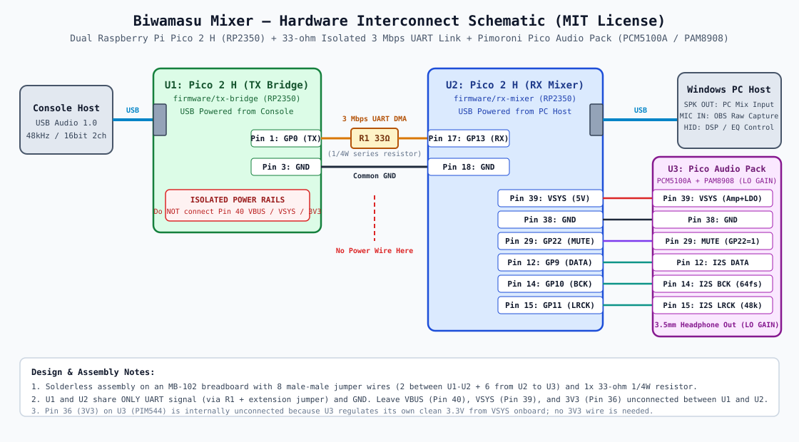
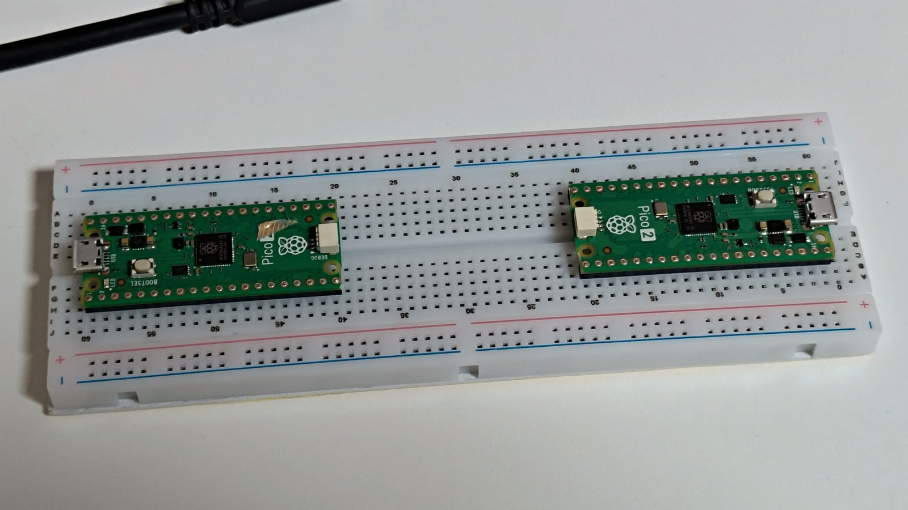
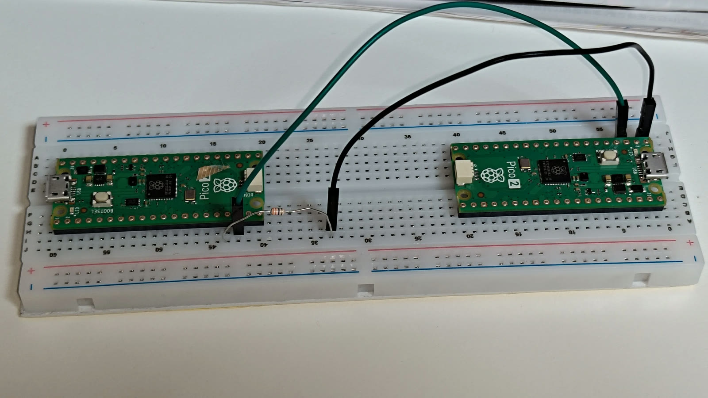

# Biwamasu Mixer
(以下AIによる説明)

**Biwamasu Mixer** は、**Raspberry Pi Pico 2 H（RP2350）× 2台 ＋ Pimoroni Pico Audio Pack** を使い、Nintendo Switch 2 の USB 音声（ヘッドホン バーチャルサラウンド ON 対応）を **約 4.6〜4.9 ms の超低遅延** で PC 音とデジタル合成して聴きながら、**OBS には無加工（EQ・減衰なし）の Switch 2 生音** を渡すオープンソースのオーディオブリッジ＆ハードウェアミキサーです。

> [!NOTE]
> **公開ビルドについて / USB VID/PID ステータス**  
> 本リポジトリのソースコードは **MIT License** で公開されています。初期状態の `include/usb_ids.h` は未設定プレースホルダー（`0x0000`）となっており、テスト用の仮 ID（`0xCAFE`）が誤って配布用バイナリに混入しないようコンパイル時にブロックされます。  
> 正規のオープンソース USB PID 取得およびリリース用バイナリのビルド手順は [docs/USB_PID_APPLICATION.md](docs/USB_PID_APPLICATION.md) を参照してください。

---

## 主な特徴・構成図



1. **超低遅延（Switch 2 → ヘッドホン 約 4.6〜4.9 ms）**
   - Windows のソフトウェアミキサーを経由せず、`Pico①`（`Biwamasu Mixer TX`）→ 3 Mbps UART（`33Ω` 抵抗経由）→ `Pico②`（`Biwamasu Mixer`）→ I2S DAC（`PCM5100A` ＋ `PAM8908`）へ直接出力します。
2. **「OBS 用の無加工生音」と「ヘッドホン用の精密 EQ・音量」を完全分離**
   - **OBS（録音）側**：USB Audio Class 2.0 入力（`マイク (Biwamasu Mixer)`、最大 `0.0 dB` 上限 Feature Unit 実装済み）へ **Switch 2 から届いた無加工の 48kHz / 16bit / ステレオ生音** を EQ 適用前に分岐してそのまま送ります。
   - **ヘッドホン側**：Switch 2 音声と PC 音（4点エルミート補間リサンプラでクロック誤差を吸収）を **デジタルミックスした後段（`MasterGain` の手前）** で最大 11 バンドのパラメトリック EQ（[Equalizer APO / Peace](https://sourceforge.net/projects/peace-equalizer-apo-extension/) 形式ファイル対応）とマスター音量を適用します。配布版の初期状態は安全のため **EQ OFF・`-45.0 dB`** です。
3. **本体フラッシュメモリに設定を保存（常駐ソフト不要）**
   - EQ 係数・各種ゲイン設定は `Pico②` 本体のフラッシュに保存でき、電源の抜き差し後も同じ状態で起動します。

---

## 必要なもの

| 品名 | 数量 | 用途・備考 |
|---|---|---|
| **Raspberry Pi Pico 2 H**（RP2350・ピンヘッダ実装済） | **2枚** | Switch 2 ドック側（`tx-bridge`）と PC 側（`rx-mixer`） |
| **Pimoroni Pico Audio Pack**（PIM544） | **1枚** | `PCM5100A` I2S DAC ＋ `PAM8908` ヘッドホンアンプ |
| **ブレッドボード（MB-102 等）** | 1枚 | 無ハンダ配線用（830穴） |
| **ジャンパワイヤ（オス-オス）** | 9本 | 1枚ボード構成の場合（離して置く場合は オス-オス 7本 ＋ オス-メス 2本） |
| **抵抗（`33Ω` カーボン等、1/4W）** | **1本** | 3 Mbps UART 信号線のダンピング用 |
| **Micro-USB ケーブル（データ通信対応）** | 2本 | PC 接続用・Switch 2 ドック接続用 |

> [!TIP]
> **対応ヘッドホンについて**  
> 本機は **3.5mm 有線ヘッドホン／イヤホン専用** です。鳴らしにくい高インピーダンス／低能率ヘッドホンで音量が足りない場合は、`Pico Audio Pack` の **`LINE OUT`** 端子から市販の外部アナログヘッドホンアンプへ接続してください。USB ヘッドホンや無線ヘッドセットは非対応のため、ご自身でのファームウェア改造（MIT License）が必要です。

---

## 1. ファームウェアの書き込み（まず単体で書き込む）

GitHub Releases の配布アーカイブ（`biwamasu-mixer-release.zip`）を展開するか、ご自身でビルドした 2 つの `.uf2` ファイルを用意します（詳細は [docs/USB_PID_APPLICATION.md](docs/USB_PID_APPLICATION.md) を参照）。ブレッドボードに挿す前に、PC へ 1 台ずつ繋いで書き込みます。

1. `Pimoroni Pico Audio Pack` 基板上にあるスライドスイッチ（`GAIN`）が **`Low`** 側になっていることを確認する。
2. **Switch 2 側にする `Pico 2 H`（以降 `Pico①`）** の白い `BOOTSEL` ボタンを押しながら PC に USB 接続し、現れた `RP2350` ドライブへ **`biwamasu-mixer-tx.uf2`** をコピーする（自動再起動したら USB を抜く）。
3. **PC 側にする `Pico 2 H`（以降 `Pico②`）** も同様に `BOOTSEL` ボタンを押しながら PC に接続し、**`biwamasu-mixer-rx.uf2`** をコピーする（自動再起動したら USB を抜く）。

---

## 2. ブレッドボード配線手順（必ず電源 OFF で作業）

配線中のショートを防ぐため、**両方の USB ケーブルを完全に抜いた状態** で作業してください。  
`MB-102` ブレッドボードはメーカーによってアルファベットや番号の向きが異なる場合があるため、印字ではなく **「USB 端子を向けた側の端の足から何番目か」** と **「奥（上側）か手前（下側）か」** で数えると間違いが起きません（※上下端の赤 `+`・青 `-` 電源レーンは使いません）。

### Step 1：2 台の Pico 2 H をブレッドボードに配置する



- 写真左側（`Pico②`・PC 側）：**USB 端子を左外向き**、白い `BOOTSEL` ボタン面を上にして中央の溝をまたぐように奥までしっかり挿します。
- 写真右側（`Pico①`・Switch 2 側）：**USB 端子を右外向き**、白い `BOOTSEL` ボタン面を上にして中央の溝をまたぐように挿します（USB ケーブル同士が干渉しません）。

### Step 2：`Pico①`（Switch 2 側）と `Pico②`（PC 側）を繋ぐ



1. **`GND` 同士（オス-オス 1本）**：
   - `Pico②` の **手前列・左から 18番目**（右端から左へ 3本目の `GND`） ⇔ `Pico①` の **奥列・右端から左へ 3本目（`GND`）**
2. **音声信号 ＋ `33Ω` 抵抗（オス-オス 1本 ＋ 抵抗 1本）**：
   - `Pico①` の **奥列・一番右端の足（`GP0`）** ⇔ ブレッドボードの使っていない空き縦列の穴
   - **`33Ω` 抵抗**（向き不問）の両足を曲げ、**同じ空き縦列の別の穴** ⇔ **`Pico②` の手前列・左から 17番目**（右端から左へ 4本目の **`GP13`**）

> [!CAUTION]
> **電源ピン同士の接続は絶対禁止**  
> `Pico①` と `Pico②` の間で **`VBUS`・`VSYS`・`3V3` などの電源ピン同士は絶対に繋がないでください。** また、`Pico①` の手前一番右端の足は **`VBUS`（5V 電源）** なので、裏面の白印字を確認して **`GP0`（奥側の一番右端）** と間違えないでください。

### Step 3：`Pico②` と `Pimoroni Pico Audio Pack` を繋ぐ（オス-オス 7本）


`Pico Audio Pack` は **黒いピンソケット穴を上・USB 印字側を左（3.5mm ジャック側を右）** に置き、`Pico②` の **左端の足を 1番目** と数えて同じ番号同士を 7 本のワイヤで繋ぎます（[hardware/README.md](hardware/README.md) に英語ピン番号ネットリストも記載しています）。

| 機能 | `Pico②` の足（左端から） | 繋ぐ側 | `Pico Audio Pack` 側の穴 |
|---|---|---|---|
| **電源 `VSYS` (5V)** | 奥列・左から **2番目** | 奥 ↔ 奥 | 奥列・左から **2番目**（`VSYS`） |
| **`GND`** | 奥列・左から **3番目** | 奥 ↔ 奥 | 奥列・左から **3番目**（`GND`） |
| **DAC 電源 `3V3` (3.3V)** | 奥列・左から **5番目** | 奥 ↔ 奥 | 奥列・左から **5番目**（`3V3`） |
| **ミュート解除 `GP22`** | 奥列・左から **12番目** | 奥 ↔ 奥 | 奥列・左から **12番目**（`MUTE`） |
| **音声データ `GP9`** | 手前列・左から **12番目** | 手前 ↔ 手前 | 手前列・左から **12番目**（`DATA`） |
| **ビットクロック `GP10`** | 手前列・左から **14番目** | 手前 ↔ 手前 | 手前列・左から **14番目**（`BCK`） |
| **左右クロック `GP11`** | 手前列・左から **15番目** | 手前 ↔ 手前 | 手前列・左から **15番目**（`LRCK`） |

> ⚠️ **注意**：奥列・左から **1番目（一番左上角）の `VBUS`** には何も繋がないでください。

---

## 3. 通電・動作確認

1. `Pico Audio Pack` の **`HEADPHONE`** ジャック（`LINE OUT` ではない方）にヘッドホンを挿します。  
   （※ 新品ジャックは硬いため、**プラグが根元まで完全に刺さっていないと「左耳しか鳴らない」状態になります**）
2. まず **`Pico②` の USB だけ** を Windows PC に繋ぎ、展開したフォルダ内で PowerShell を開いてテストトーン（左 440 Hz / 右 660 Hz）を確認します：
   ```powershell
   .\scripts\Control-BiwamasuMixer.ps1 -TestTone On
   # 左右から正しく聞こえたら停止
   .\scripts\Control-BiwamasuMixer.ps1 -TestTone Off
   ```
3. **`Pico①` の USB** を Switch 2 ドックに接続し、Switch 2 本体の「設定」→「オーディオ」→ **USB 出力音量を最大**・**ヘッドホンの音声出力を「バーチャルサラウンド」ON** にします（出力先に **`Biwamasu Mixer TX`** が表示されます）。
4. ステータスを確認し、`UartLocked: true`・`ActiveUartRxPin: "GP13"`・`CrcErrors: 0` になっていれば正常です：
   ```powershell
   .\scripts\Control-BiwamasuMixer.ps1
   ```

---

## 4. Windows と OBS の設定

### Windows の再生（PC 音も一緒に聴く）
- Windows 右下のスピーカーアイコン → 出力先を **`ヘッドホン (Biwamasu Mixer)`** に切り替えます。
- Windows の音量スライダーを動かすと **PC 側の音量だけ** 変わり、Switch 2 の音量には影響しません。

> [!IMPORTANT]
> **PC 側の Equalizer APO / Peace 等は必ず OFF にしてください（二重 EQ 防止）**  
> `Pico②` の 11 バンド EQ は **「Switch 2 音 ＋ PC 音のミックス後」** に掛かります。そのため、Windows 側で `ヘッドホン (Biwamasu Mixer)` に対して Equalizer APO / Peace などのイコライザーを有効にしていると、PC 音だけ **EQ が二重に掛かってしまいます**。PC 側の EQ ソフトはこのデバイスに対して無効化（OFF）にしてお使いください。

### OBS の録音（Switch 2 生音を取り込む）
- OBS「ソース」→ `＋` →「音声入力キャプチャ」→ デバイスに **`マイク (Biwamasu Mixer)`** を選択します。
- **Windows マイク設定の確認**：Windows「設定」→「システム」→「サウンド」→「入力」→ `マイク (Biwamasu Mixer)` を開き、**入力音量を `100`（上限 `0.0 dB` 設計のため勝手なブーストなしの等倍です）**、**「オーディオの強化」を「オフ」** にしてください。
- **OBS の音量スライダー目安**：ゲーム映像とゲーム音だけ録る場合は **`-3.0 dB 〜 0.0 dB`** 付近、自分のマイク実況や Discord 通話も混ぜる場合は **`-15 dB 〜 -10 dB`** 付近が目安です。
- **OBS 同期オフセット目安**：実測では無加工音声が映像より数ミリ秒早く届くため、初期値 **`0 ms`** でも 60fps で 0.3 コマ以内の高精度です（さらに厳密に合わせる場合は「オーディオの詳細プロパティ」→「同期オフセット」に **`+5 ms` 前後**、キャプチャボード側の映像遅延がある場合はそれに合わせて調整してください）。

---

## 5. 音量調整・EQ 適用・本体保存コマンド（`Control-BiwamasuMixer.ps1`）

すべて [scripts/Control-BiwamasuMixer.ps1](scripts/Control-BiwamasuMixer.ps1) から実行できます。

- **全体音量（`-MasterDb`）の調整と本体保存**：
  ```powershell
  # 例：全体音量を -38 dB にして、電源オフ後も維持されるよう Pico② 本体に保存する
  .\scripts\Control-BiwamasuMixer.ps1 -MasterDb -38 -Save
  ```
- **Peace 形式 EQ ファイルの読み込み・有効化・保存（最大 11 バンド、`Switch 2 ＋ PC 音` の両方に適用）**：
  ```powershell
  # 見本ファイル（presets\sample-peace.txt）を任意の値に編集、または自作 Peace ファイルを指定して ON・保存
  .\scripts\Control-BiwamasuMixer.ps1 -PeaceFile .\presets\sample-peace.txt -Eq On -Save
  ```
  （※ 同梱の [presets/sample-peace.txt](presets/sample-peace.txt) は全バンド `0 dB` の記入見本です。EQ を切りたいときは `-Eq Off -Save` を実行してください）
- **Switch 2 音と PC 音のバランス調整**：
  ```powershell
  # 例：Switch 2 側を -6 dB、PC 音を -3 dB にして保存
  .\scripts\Control-BiwamasuMixer.ps1 -GameDb -6 -PcTrimDb -3 -Save
  ```
- **設定を工場出荷状態（EQ OFF / `-45.0 dB`）に戻す**：
  ```powershell
  .\scripts\Control-BiwamasuMixer.ps1 -ResetDefaults -Save
  ```
- **再書き込み用に BOOTSEL モードへ入れる**（`Pico②` 用）：
  ```powershell
  .\scripts\Control-BiwamasuMixer.ps1 -Bootsel
  ```

---

## 免責事項・商標について（Disclaimer & Trademarks）

- 本プロジェクトは個人のオープンソース実験・制作物であり、**任天堂株式会社、Raspberry Pi Ltd、Pimoroni Ltd その他各社とは一切関係なく、公式製品・認証製品でもありません。**
- 記載されている製品名・会社名等は各社の商標または登録商標です。
- 配線ミス（特に `VBUS` 電源ピン同士の接続等）は接続機器の故障につながるおそれがあります。制作・使用はすべて自己責任で行ってください。
- 大音量による聴覚障害を防ぐため、初期音量は `-45.0 dB` に抑えてありますが、使用前に必ずヘッドホンアンプのゲインスイッチを **`Low`** にして音量を確かめてください。

---

## English Summary (For Open-Source Hardware & USB PID Reviewers)

**Biwamasu Mixer** (formerly `Switch2 Pico Audio Pack Bridge`) is a dual-RP2350 open-source USB audio bridge and hardware mixer licensed under the **MIT License** (`Copyright (c) 2026 mugicha_xtx`).

### Architecture & Hardware
- **Hardware Platform & Schematic**: Two physically wired, non-wireless **Raspberry Pi Pico 2 H** (`RP2350`, `PICO_BOARD=pico2`, no `cyw43` wireless stack) paired with a **Pimoroni Pico Audio Pack** (`PCM5100A` I2S DAC + `PAM8908` headphone amp). Complete circuit diagram, BOM, and netlist are documented in **[hardware/README.md](hardware/README.md)** ([hardware/schematic.svg](hardware/schematic.svg)).
- **Inter-MCU Link**: Unidirectional 3 Mbps UART DMA link (`GP0` TX -> `33Ω` series resistor -> `GP13` RX, common `GND`, isolated power rails) carrying `S2AUD002` framed 48 kHz / 16-bit stereo PCM packets with IEEE CRC32 integrity checking.

### Two Separate USB Functions (Why Two USB PIDs Are Requested)
1. **`firmware/tx-bridge` (`biwamasu-mixer-tx.uf2`, `BRIDGE_USB_PID`) — Console USB Host Port**
   - Enumerates as **`Biwamasu Mixer TX`**: a **UAC 1.0 stereo 48 kHz speaker receiver + Vendor HID interface (`S2B4`)** with software BOOTSEL support.
   - Receives digital stereo PCM over USB from the console host and streams packets over UART without re-encoding.
2. **`firmware/rx-mixer` (`biwamasu-mixer-rx.uf2`, `MIXER_USB_PID`) — PC USB Host Port**
   - Enumerates as **`Biwamasu Mixer`**: a **UAC 2.0 composite Headset (Speaker OUT + Microphone IN) + Vendor HID control interface (`UAP1`)**.
   - **Speaker OUT & Mixed Bus EQ**: Accepts 48 kHz stereo PC audio, resamples via 4-point Catmull-Rom Hermite interpolation, and mixes digitally with UART console audio before applying the shared **post-mix 11-band floating-point biquad EQ** (`~5 ms` console-to-headphone latency, default EQ OFF / `-45.0 dB` master gain) and 32-bit PIO I2S output.
   - **Microphone IN**: Branches upstream of the mixer/EQ and streams bit-exact pre-EQ raw console PCM (`0.0 dB` max Feature Unit so Windows level `100` is unity pass-through with no OS mic boost) for clean OBS recording.
   - **Vendor HID**: Allows the host script (`scripts/Control-BiwamasuMixer.ps1`) to load EQ filters, set gains, save configuration to flash, read diagnostics, or enter BOOTSEL.

### Build & Dependencies
- Build configuration and dependency provenance are documented in [THIRD_PARTY_NOTICES.md](THIRD_PARTY_NOTICES.md) and reproduced portably via `scripts/Setup-Toolchain.ps1` and `scripts/Build-Release.ps1` (which also packages `dist/biwamasu-mixer-release.zip` including `LICENSE`, `THIRD_PARTY_NOTICES.md`, `licenses/`, scripts, presets, docs, and clean metadata-free images).
- Project source uses `include/usb_ids.h` (`0x0000` placeholders with compile-time `#error`) until official open-source USB PIDs are assigned.
