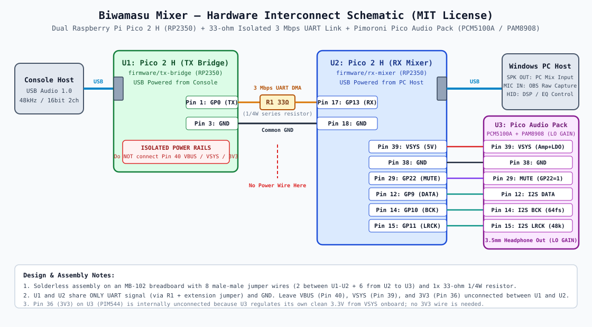

# Hardware Design & Pinout Schematic

This project uses off-the-shelf open hardware modules assembled **without soldering** using a **Pimoroni Pico Omnibus (Dual Expander)** and two short (`<= 20 cm`) female-to-female jumper wires — no breadboard, external resistor, or custom PCB is required.

---

## Bill of Materials (BOM)

| Ref | Part | Description |
|---|---|---|
| `U1` | **Raspberry Pi Pico 2 H** (`RP2350`) | Console-side USB Audio 1.0 receiver (`firmware/tx-bridge`, standalone outside Omnibus) |
| `U2` | **Raspberry Pi Pico 2 H** (`RP2350`) | PC-side USB Audio 2.0 composite mixer & 11-band DSP (`firmware/rx-mixer`, plugged into Omnibus center socket) |
| `U3` | **Pimoroni Pico Audio Pack** (`PIM544`) | `PCM5100A` I2S DAC + `PAM8908JER` headphone amp (`GAIN` switch = `LO GAIN`, plugged into Omnibus Deck 2) |
| `B1` | **Pimoroni Pico Omnibus** (Dual Expander) | Connects `U2` and `U3` directly with 0 loose I2S wires and exposes `GP1`/`GND` on Deck 1 |
| `W1..W2` | Female-to-female jumper wires (2x, `<= 20 cm`) | Short ribbon pair linking `U1` (`GP0`, `GND`) to Omnibus Deck 1 (`GP1`, `GND`) |
| `OPT1` | **ADuM3160 USB Isolator** (12 Mbps Full-Speed, optional) | Plugged into Switch 2 Dock USB-A port to eliminate HDMI capture card ground-loop hum |

> **Why both `U1` and `U2` must be Pico 2 H (`RP2350`)**: RP2350 digital GPIOs (`GP0`, `GP1`) are 3.3V failsafe even when one board is unpowered (`IOVDD = 0 V`), and `tx-bridge` enables `2 mA` drive strength + `SLOW` slew rate on `GP0` for clean 3 Mbps signaling over a `<= 20 cm` direct jumper without an external `33Ω` resistor.

---

## Netlist (Pin-to-Pin Wiring)

### 1. Pimoroni Pico Omnibus Direct Plug-in (`U2` + `U3`)

- Plug **`U2` (PC-side Pico 2 H)** into the **center female socket** of `Pico Omnibus`.
- Plug **`U3` (Pimoroni Pico Audio Pack)** into **one side male deck** (Deck 2) of `Pico Omnibus`.
- **Align the `"USB"` silkscreen orientation** on every board so Pin 1 matches Pin 1.
- Set the `GAIN` slide switch on `U3` to **`LO GAIN`**.

Because all three decks of `Pico Omnibus` are wired 1:1 in parallel on the PCB, `U2` and `U3` share `VSYS` (Pin 39), `GND`, `GP9` (`DATA`, Pin 12), `GP10` (`BCK`, Pin 14), `GP11` (`LRCK`, Pin 15), and `GP22` (`MUTE`, Pin 29) automatically with zero jumper wires.

### 2. Inter-MCU 3 Mbps UART Link (`U1` Console <-> Omnibus Empty Deck)

Place **`U1` (Switch 2-side Pico 2 H)** beside `Pico Omnibus` and connect **only two short female-to-female jumper wires (`<= 20 cm`)**:

| Net Name | From (`U1` TX Bridge) | To (Omnibus Empty Deck -> `U2`) | Notes |
|---|---|---|---|
| `UART_TX_RX` | Physical Pin `1` (`GP0`) | Physical Pin `2` (`GP1`) | Unidirectional 3,000,000 bps 8N1 DMA (default `GP1`; `GP13` Pin `17` remains selectable via HID for legacy breadboard wiring) |
| `GND_LINK` | Physical Pin `3` (`GND`) | Physical Pin `3` (`GND`) | Common logic reference adjacent to Pin 2 (`GP1`) |

> **CRITICAL Power Isolation Rule**: **NEVER plug `U1` directly into the empty deck of `Pico Omnibus`**, and never connect `VBUS` (`Pin 40`), `VSYS` (`Pin 39`), or `3V3(OUT)` (`Pin 36`) between `U1` and `Pico Omnibus`/`U2`. All 40 pins on `Pico Omnibus` are shorted in parallel across its three decks, so plugging `U1` directly in would short Switch 2's 5V USB rail against PC's 5V USB rail and cause `GP0` bus contention. Each Pico 2 H must be powered solely by its own USB host.

### 3. Optional USB Isolator Placement (`OPT1`)

If your Switch 2 and PC are also linked via an HDMI capture card and you hear ground-loop hum or GPU coil whine, insert a commercial **ADuM3160** (12 Mbps Full-Speed) USB isolator at the console dock:

`Switch 2 Dock USB-A` -> **`ADuM3160 USB Isolator`** -> `Micro-USB Cable` -> **`U1` (TX Bridge)**

Placing the isolator on the console side keeps its internal isolated DC-DC switching noise physically separated from the PC-powered analog DAC (`U3`).

For step-by-step Japanese assembly instructions, 100-yen PP enclosure tips, and software setup, see [README.md](../README.md).
